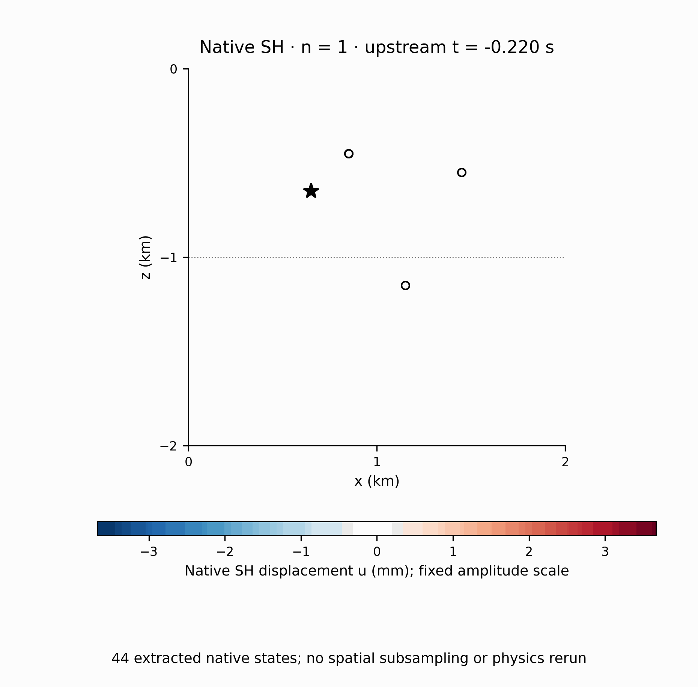
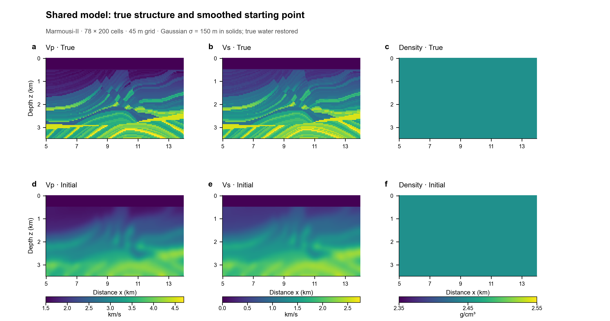
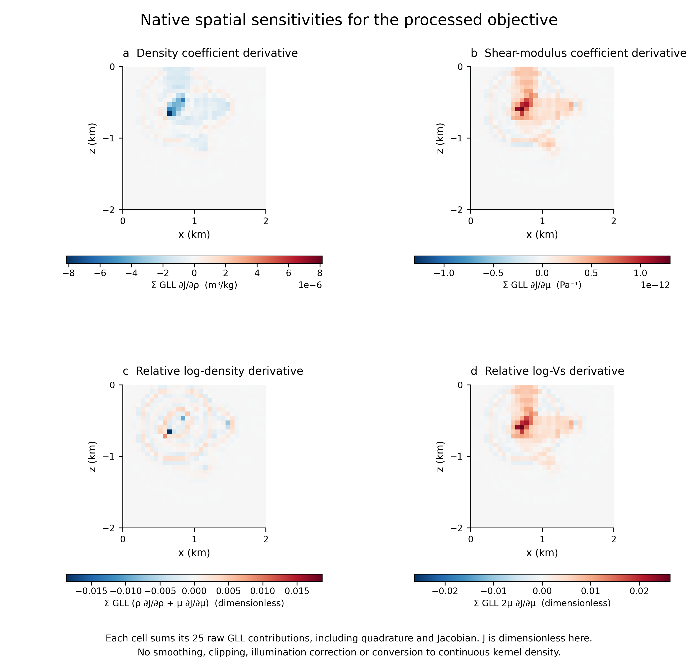
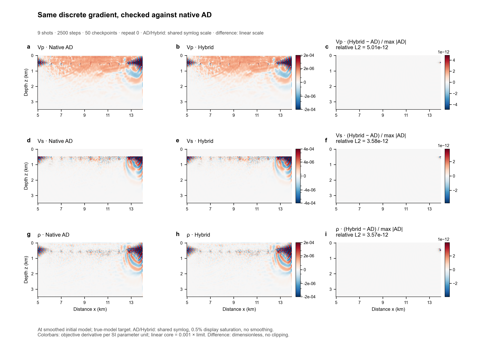
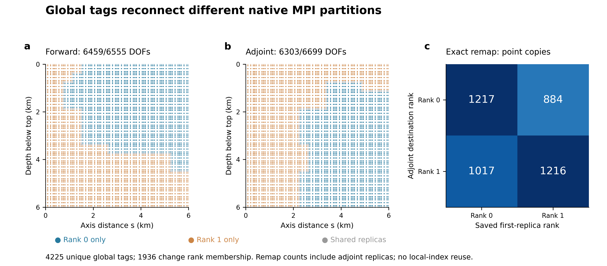

# SeismicDiffSkill

Make an existing high-performance seismic **source** solver usable in differentiable inversion: data AD supplies the actual objective VJP, and a consistent native adjoint supplies the propagation VJP. Preserve native numerical kernels/execution and deliver **visual evidence alongside numerical checks**. The skill is solver-independent; an already differentiable framework is a separate comparison.



Actual native two-rank history, shared amplitude scale and physical geometry. This is an application example, not a solver-specific recipe inside the skill.

| Actual target and starting model | Native coefficient sensitivities |
| --- | --- |
| [](docs/gallery/README.md) | [](docs/gallery/README.md) |
| Separate HybridADFWI comparison: actual Gaussian-smoothed velocities and restored true water. | Raw SEM contributions with declared quadrature and parameter coordinates. |
| **Matched gradients** | **MPI history identity** |
| [](docs/gallery/README.md) | [](docs/gallery/README.md) |
| Same starting point, shared scales; differences have a separate scale. | Global tags connect forward history to a different adjoint partition. |

[Full gallery / attribution](docs/gallery/README.md) · [Portable renderer example](docs/visual-demo/README.md) · [Application records](evaluations/applications.json) · [Independent reviews](evaluations/reviews/)

## What the skill must deliver

| Evidence | Required output |
| --- | --- |
| Model | Actual target/starting model and differences; name smoothing only when used |
| Native wavefield | Time snapshots, geometry/components/units; animation when feasible |
| AD boundary | Prediction, observation, residual and actual objective cotangent |
| Derivative | Raw coefficient/model gradients; bars for regional parameters |
| Correctness | Native comparisons, full dot/Taylor sweeps, failures and numerical floors |
| Resources, if measured | Matched time/memory and all repeat points |

Each gallery includes plotting source, a reproduction command and source/figure manifests. Shared scales, clipping and aggregation are explicit. A waveform picture never replaces a numerical check. Read the [visualization contract](skills/differentiate-seismic-solver/references/visualization-deliverables.md).

## Install and use

Current visual-delivery skill: **v0.2.0**. Copy `releases/v0.2.0/skill` to `~/.codex/skills/differentiate-seismic-solver`, or link it. Invoke `$differentiate-seismic-solver` with a source solver and small native example. Editable package: `skills/differentiate-seismic-solver/`.

Optional NumPy/Matplotlib/Pillow renderer:

```bash
python skills/differentiate-seismic-solver/scripts/visualize.py \
  --arrays case.npz --spec figures.json --output figures
```

Exports PNG/PDF/SVG, optional native-frame GIFs, scale/clipping statistics and a Markdown report. It does not run a solver, invent fields, smooth gradients or force one adapter architecture; native-aware custom plotting remains valid.

## Versions and evidence

| Version / project | Role and verified scope |
| --- | --- |
| Frozen v0.1.0 | Original adaptation packet; 26 utility checks and 43 independent compiled-fixture gates |
| v0.2.0 | Required visual report, real embedded example, portable renderer; four new artifact/integrity tests and independent 7-plate + GIF visual report |
| [DiffSPECFEM](https://github.com/Wangxi404/DiffSPECFEM) | v0.1.0 application: native SH, regional logρ/logVs, ranks 1/2, additional 32×32 case |
| [DiffAxiSEM3D](https://github.com/Wangxi404/DiffAxiSEM3D) | v0.1.0 application: Nr1/m0 solid, two common λ/μ layer factors, ranks 1/2, 16×16 case and actual repartition |
| [HybridADFWI](https://github.com/Wangxi404/HybridADFWI-Open) | Separate already-differentiable ADFWI comparison; **not a skill target** |

Both native applications used the **same frozen v0.1.0 packet**, before this visual follow-up. They are not relabelled as v0.2.0 numerical adaptations. Both passed independent native/raw-history reviews, real processed-objective AD, model/propagation/sampling dot/Taylor checks. Refined strict forward preservation in the second application uses a separately labelled matched NR-partition control; derivatives retain COST partitioning. Scope, source pins and repair inputs are in the reports. These results establish neither all-physics support nor continuum convergence, universal adaptation speed or a causal no-skill comparison.

## Reproduction and integrity

```bash
python -m pip install -r requirements-dev.txt
python -m pytest tests -q
python tools/freeze.py verify releases/v0.1.0 \
  --expected-sha256 b09e0ee57324f715b80178c2a30cb26a2140b1ea3d5545ad8b15dc5680dca49f
```

Verify the visual-delivery packet with `python tools/freeze.py verify releases/v0.2.0 --expected-sha256 51b19130b19625fb074f76db5165e6517d662a61079723e0381d62bfb96f947a`. The independent [visualization forward-test report](evaluations/visualization_forward_test/README.md) retains its actual outputs and limitations.

Manifests cover the complete packet: instructions, references, helpers, assets, license and UI metadata. Adapters/reviews stay outside it. Changes create new versions; old freezes are never overwritten. Native fixture reproduction additionally needs C++17 and PyTorch: `PYTHON=/path/to/torch-python evaluations/generic_forward_test/reproduce.sh`.

Generic skill: MIT. Gallery assets retain source terms in [SOURCES.json](docs/gallery/SOURCES.json); Marmousi-II provenance/terms are separate. The original private comparison history and manuscript are not included in its clean public export.
