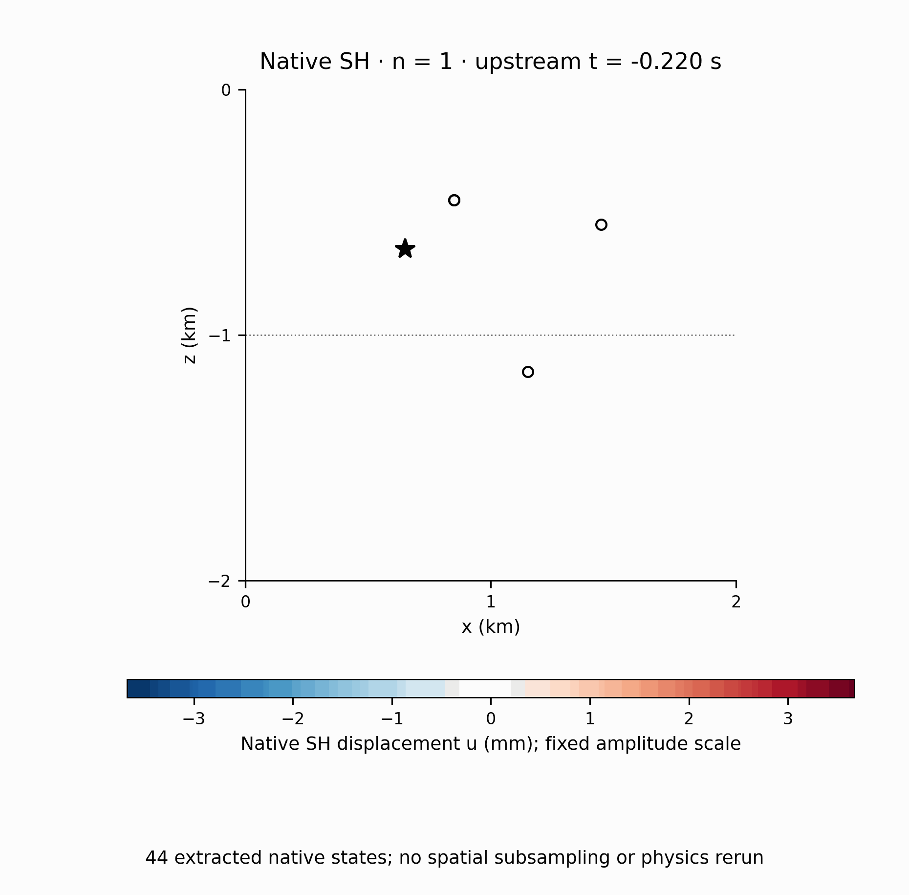
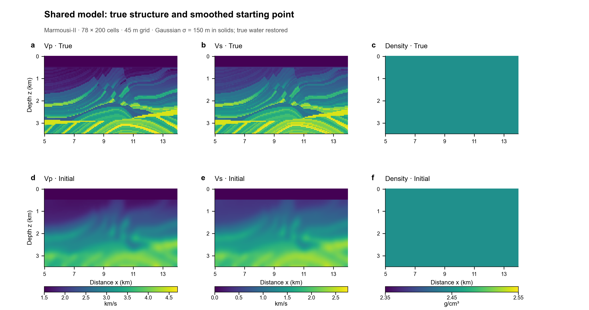
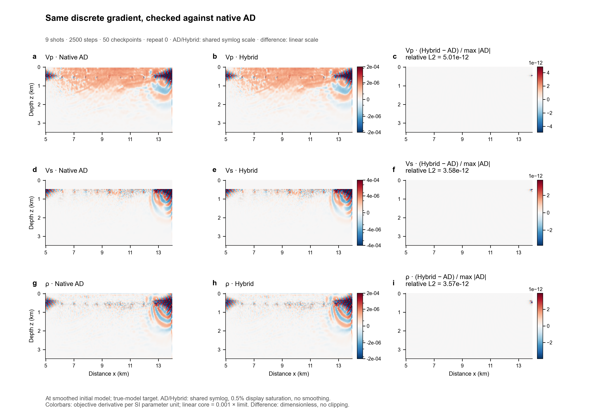
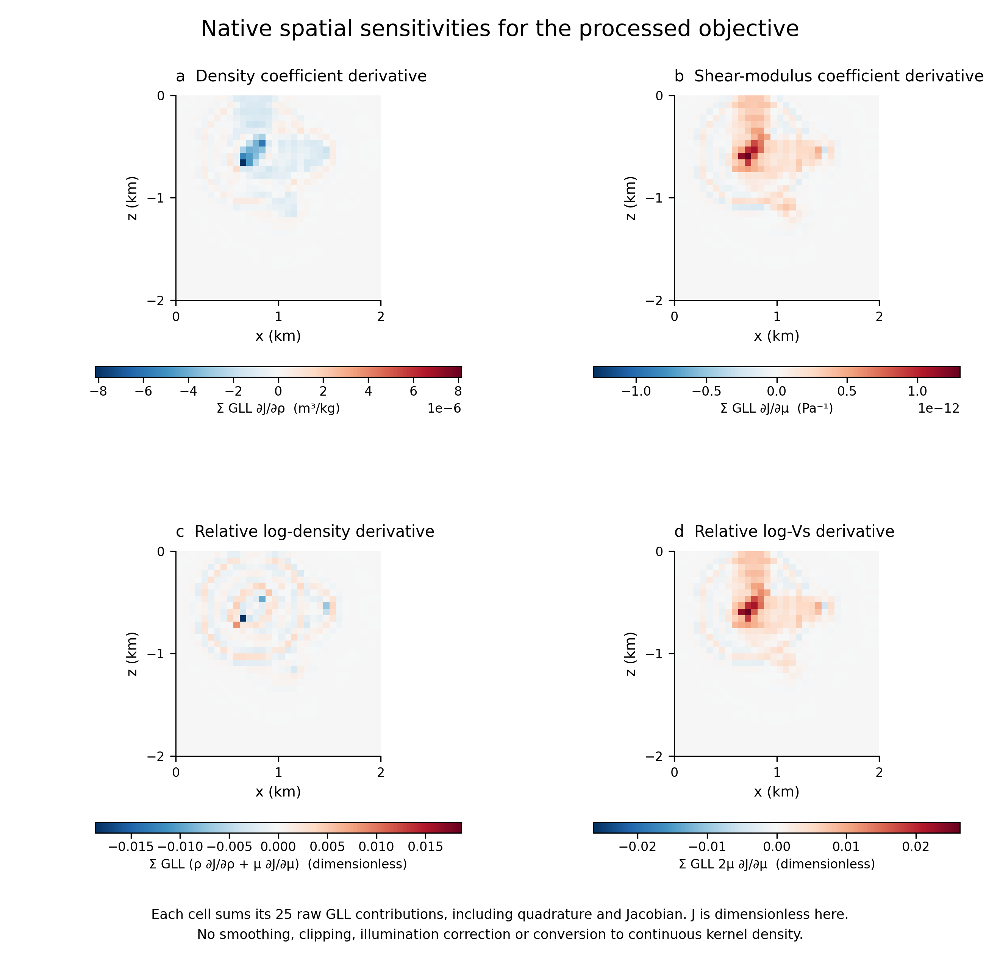
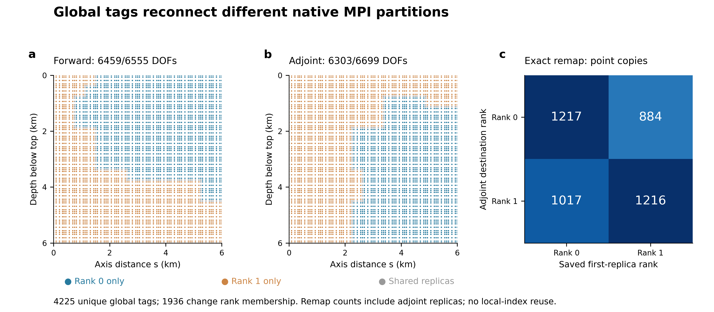

# Outputs the skill must deliver

These figures are copied from actual application/comparison records. Their source commits and SHA256 values are in [SOURCES.json](SOURCES.json); source-project terms and data attribution are retained. The operative skill remains solver-independent.

## Native propagation

Actual native two-rank history, 44 selected time frames, common scale. [Full native report](https://github.com/Wangxi404/DiffSPECFEM/blob/main/VISUAL_REPORT.md).

## Actual true and smoothed starting model

This is the independent HybridADFWI comparison, **not a skill target**. Initial velocities use the actual150m Gaussian preparation with water restored; density is constant in this benchmark. Marmousi-II: University of Houston/AGL, Gary S. Martin, Robert Wiley and Kurt J. Marfurt. Source/data terms remain independent of the code license.

Gradients are evaluated at the smoothed starting model using true-model observations. Shared signed symlog scales disclose display saturation; differences use their own linear scale. Raw arrays are unfiltered. [Full comparison gallery](https://github.com/Wangxi404/HybridADFWI-Open/blob/main/docs/VISUAL_REPORT.md).

## Native coefficient sensitivities

Each cell sums its25 native GLL coefficient contributions; this is not a continuous kernel density or a reconstructed model.

## State identity under native MPI repartition

Native point tags connect the saved forward history to a differently partitioned adjoint. [Full meridional-wavefield and regional-gradient gallery](https://github.com/Wangxi404/DiffAxiSEM3D/blob/main/docs/gallery/README.md).

## Portable renderer example

[Real compiled1-D fixture example](../visual-demo/README.md), [input specification](../visual-demo/figures.json), and [plotting command](../../tools/render_visual_demo.py). This development example supports the visualization helper, not a seismic accuracy claim.
