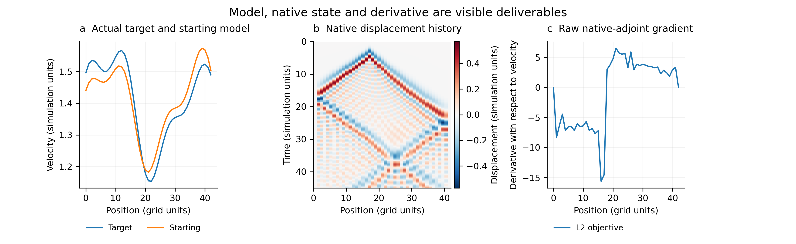
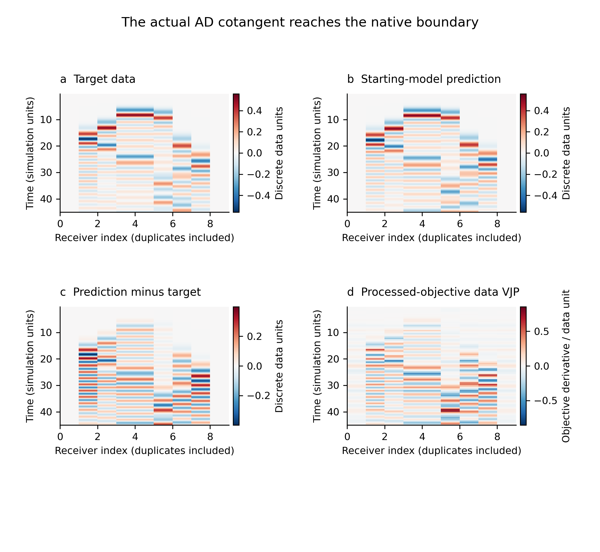
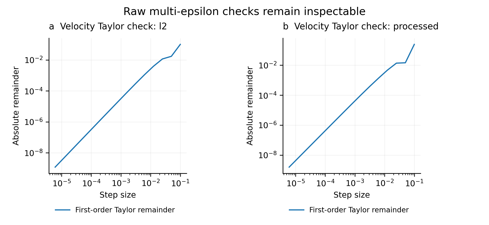

# Visual report

## Model, native state and derivative are visible deliverables

Actual arrays from the compiled 1-D scalar-wave development fixture. The starting model is not called blurred: no smoothing was used. The history includes the zero initial state. The raw gradient is data AD followed by the native C++ adjoint and a static material-map VJP; no display smoothing or clipping. This is a workflow example, not a geophysical accuracy or HPC benchmark.

## The actual AD cotangent reaches the native boundary

Actual target/prediction, residual and processed-objective receiver derivative. Cotangent and residual have separately labelled scales; they are different quantities.

## Raw multi-epsilon checks remain inspectable

Every retained positive first-order remainder in the actual aligned-velocity Taylor sweep is plotted, including the smallest steps. No step selection or fitted rescaling.
