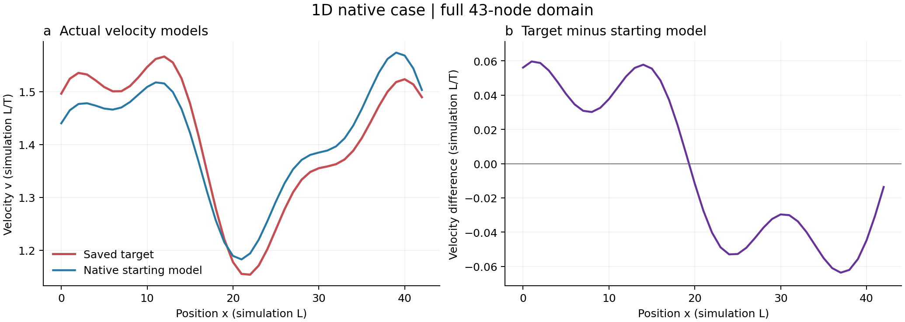
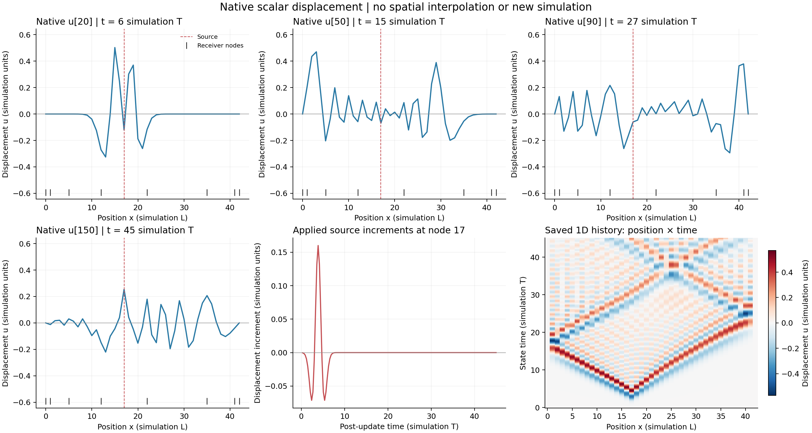
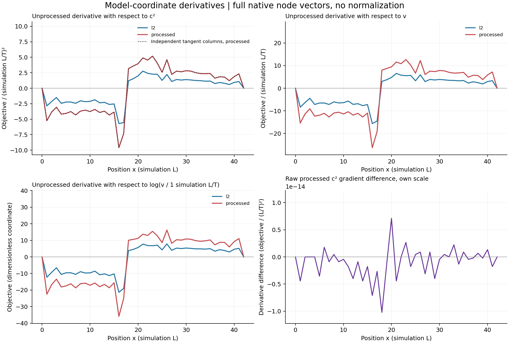
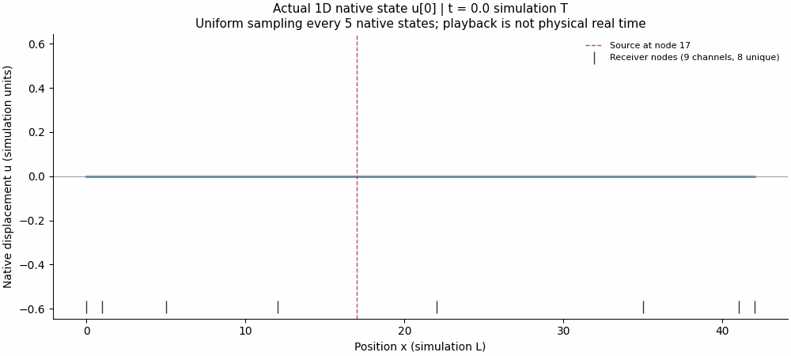
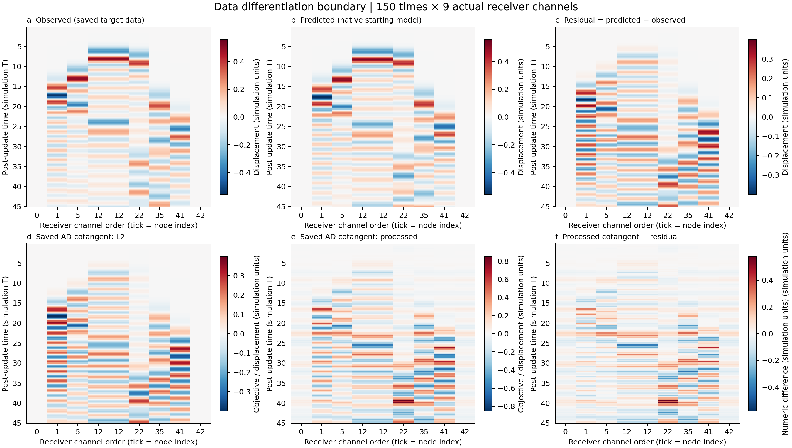
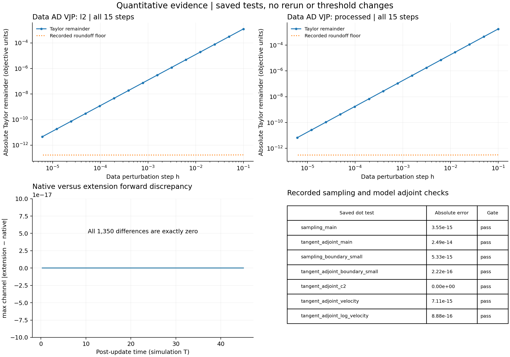
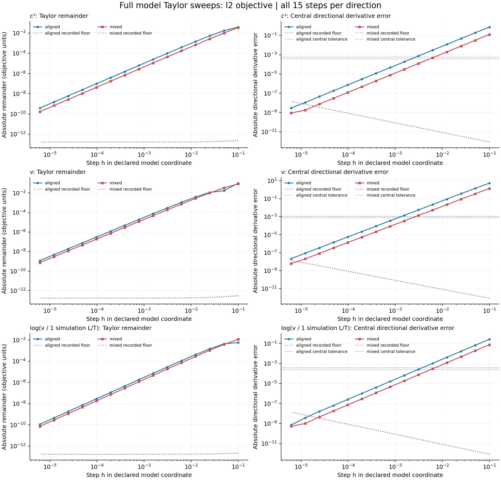
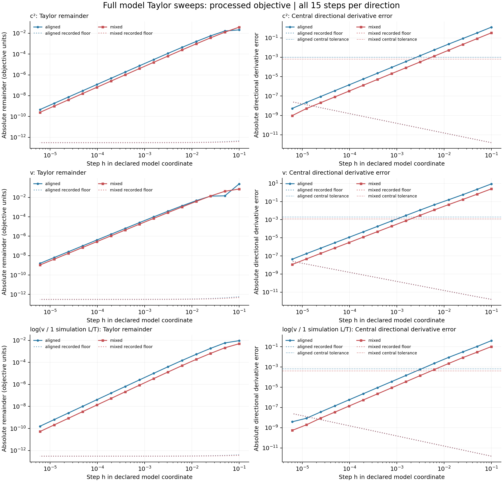

# Saved native 1D visual report

These figures use the supplied native solver arrays and saved derivative checks. They show the actual target and starting models, the starting-model native state, receiver data and AD cotangents, and model-coordinate gradients. This application only plots and audits saved outputs; it does not run a solver or implement AD.







| Configuration | Saved case |
|---|---|
| Physics | One-dimensional scalar displacement; fixed zero endpoints; fixed nonuniform damping |
| Grid | 43 native nodes, x = 0…42 simulation L; dx = 1 |
| Time | 150 updates; dt = 0.30 simulation T; history t = 0…45 |
| Precision / execution | float64 exports; serial native C++; CPU only |
| State / observation | History u[n] at n dt includes the zero initial state; trace[t,r] = u[t+1, receiver[r]] |
| Source | Direct displacement increment after damping at native node 17; inferred from first saved state/source identity |
| Receiver channels | [0, 1, 5, 12, 12, 22, 35, 41, 42]; duplicate and endpoint channels retained |
| Active model coordinates | c²; v with c²=v²; log(v / 1 simulation L/T); fixed endpoints have zero derivative |
| Fixed quantities | Damping, source, geometry, dt, dx, initial states and boundaries |
| History | Full native 151 × 43 displacement states; no replay |
| Units | Nondimensional simulation units with consistent arbitrary L and T; no kilometres/seconds are asserted |

| Result | Evidence |
|---|---|
| Historical numerical gates | All passed; zero recorded failures; full steps/thresholds preserved |
| Native / extension data | Bitwise equal; raw maximum absolute difference 0 |
| Post-update sampling | Bitwise equality with native history at u[t+1, receiver[r]] |
| Saved L2 / processed objectives | 5.947819465134299 / 10.75316959299695 |
| Processed c² gradient / independent tangent columns | Raw maximum absolute difference 1.021405182655144×10⁻¹⁴ |
| Saved recurrence audit | Maximum absolute mismatch 1.1102230246251565×10⁻¹⁶ |

The starting model is the saved model actually associated with the native history; its saved recurrence is checked directly, without integrating a new state. No smoothing operation is assumed. Gradients are discrete node-vector derivatives, not continuous kernel densities. They are plotted without smoothing, normalization, clipping or fitted scaling.

## Native state animation



The animation retains all 43 nodes and every fifth saved state, including indices 0 and 150. It uses the same full-history amplitude limit for every frame. Playback is 10 frames/s and does not represent physical real time. A position–time image is labelled as such; it is not a two-dimensional wavefield.

## Data differentiation boundary



Observed and predicted fields share their full signed scale. Residual and saved L2 AD cotangent share a scale and are bitwise equal. The L2 objective is ½Σ(predicted − observed)², consistent with the raw sum and recorded objective. The processed objective uses its actual saved data cotangent, which differs from the residual. The supplied artifacts do not specify that processing operator or its exact formula, so no operator or processed data are invented.

## Quantitative checks



Native and extension traces are bitwise equal, and the post-update sampling relation is bitwise satisfied. The report displays the saved data-objective Taylor sweeps and adjoint dot errors; the original numerical run reports all gates passed and no failures. These are historical numerical results, not newly run correctness checks. Exact test values, thresholds, coarse nonmatching steps and roundoff regions remain in [the original saved result record](inputs/results.json).





All 15 step sizes are shown for each model coordinate and both aligned/mixed directions. Central derivative errors use their own panels and declared tolerances. No numerical thresholds were changed.

## Reproduce and inspect provenance

From this report directory, run:

```sh
MPLCONFIGDIR="$PWD/mplconfig" XDG_CACHE_HOME="$PWD/cache" python3 plot_report.py --arrays inputs/raw_arrays.npz --results inputs/results.json --contract inputs/CONTRACT.md --out figures
```

The command needs NumPy, Matplotlib and Pillow. The source is [plot_report.py](plot_report.py). Each plate is exported as PNG, editable SVG and PDF. Input hashes, exact array keys, state times, coordinate definitions, source identity, transforms, full-range statistics, zero-clipping policies and outputs are recorded in [the figure manifest](figures/manifest.json). Rendered axes positions and canvas text bounds are recorded in the per-plate alignment files. [QA](QA.md) records the visual and PDF inspections.

Frozen candidate integrity is recorded [before](integrity-pre.log) and [after](integrity-post.log). The plotting-only application uses candidate v0.2.0-rc1; the historical numerical artifacts record v0.1.0-rc1 and retain their original provenance. The visual candidate is never edited. [Attempts and limitations](attempts.json) retain any rendering warning or repair.

Only the starting-model native history was saved; the target wavefield is therefore absent. Original timing repeat samples are unavailable, so no uncertainty or speedup plot is inferred from phase averages. No target-repository README was modified during this isolated forward test.

## Archive clarification

All-pass statements refer to the supplied **final** numerical record. Earlier numerical development attempts are preserved separately in `../generic_forward_test/attempts.json`; they were outside this plotting-only input set. Only this README reproduction path and this clarification were added during archival; the independent plotting source and assessment are retained unchanged.
