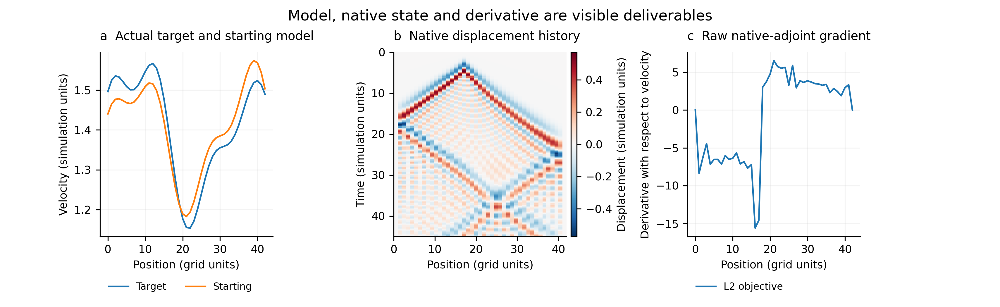

# Differentiate an existing seismic solver

Deliver a runnable objective-to-model-gradient extension around the supplied source solver. The reusable part is the adaptation and verification procedure; choose interfaces appropriate to the actual solver, not a mandatory common architecture or language.

## Establish the numerical contract

- Pin the input source revision and a small, working native forward example. Record build/runtime settings, precision inside the solver and in exported files, model coordinates, source and receiver conventions, and the original output. Keep the upstream baseline recoverable.
- Identify the state updates, coefficient map, observation operator, fixed numerical settings, native adjoint and kernel facilities, and available history/storage mechanisms. An existing native adjoint is useful but is not a prerequisite; deriving missing transpose/sensitivity operations from the source is within scope.
- Prefer an independent wrapper/extension and optional history hooks. If source instrumentation is necessary, keep it outside the vendor tree where possible, or produce an explicit patch. Preserving numerical updates is not the same as claiming zero source changes or zero overhead.
- Read [the derivative contract](references/derivative-contract.md) before implementing source conversion, the adjoint, or parameter gradients. State the supported physics, active parameters, and quantities deliberately held fixed.

## Implement the differentiation boundary

1. Execute native propagation without a general-purpose temporal AD tape. Preserve its numerical kernels, build, mesh, and parallel execution. Use its existing adjoint/sensitivities when suitable; otherwise implement the required transpose updates and sensitivity accumulation consistently with the actual discretization.
2. Expose receiver data as a new differentiable leaf. Evaluate the real data objective, including all differentiable processing, and compute its VJP with AD. Convert this data cotangent to the native adjoint source using the sampling transpose and the solver's units, quadrature, signs, components, and time convention.
3. Run the native adjoint and return coefficient/model-coordinate gradients. An optional static coefficient or outer model-parameterization VJP may use AD; keep that graph outside the no-grad temporal calculation.
4. Choose and disclose full history, checkpoint replay, native reconstruction, or another consistent state policy. Count storage and replay. One temporal segment is not automatically disabled checkpointing: inspect the actual route.

Do not replace the production gradient with a parameter finite-difference sweep or an AD reimplementation of the wave solver. Such computations may be independent checks on small cases. A custom backward wrapper may itself have a `grad_fn`; verify the internal propagation route rather than demanding that every external output have none.

## Verify before making resource claims

Read [numerical acceptance](references/numerical-acceptance.md). At minimum provide:

- native-versus-extension forward agreement on the same discrete example;
- data-objective VJP checks for both a standard target and a nontrivial differentiable processing/target;
- sampling and, where feasible, propagation/model adjoint inner-product checks in declared coordinates;
- non-vacuous, multi-step-size model directional/Taylor checks for the advertised parameter families;
- evidence that the end-to-end production path uses data AD, native adjoint and the declared history policy, including absence of a hidden temporal-AD or parameter-FD fallback.

Use the reusable functions or CLI in [scripts/numerics.py](scripts/numerics.py) for comparisons, dot tests, and Taylor sweeps. They support checks; they do not choose physical coordinates or excuse a mismatched test. Do not relax thresholds after a failed run without documenting a numerical justification and retaining the failure.

## Package the result

Deliver a visual report, not only text or a numerical pass flag. Read [visualization deliverables](references/visualization-deliverables.md): show the actual target and starting model, native wavefields, receiver data/residuals and AD cotangent, model gradients in their true coordinates, and numerical verification. Put a small gallery and configuration/result tables near the top of the repository README; keep detailed provenance and failures linked below. Include a reproducible plotting command, physical units, shared comparison scales and source/figure manifests. A waveform image never replaces quantitative correctness gates.

The optional self-contained [visualization helper](scripts/visualize.py) renders array maps, scattered native points, curves, regional bars and sampled wavefield animations from NPZ plus a JSON specification. Use custom native-aware plotting when it better represents the discretization; no common solver architecture or export schema is mandatory. Never invent wavefields or turn a few regional derivatives into an apparent spatial kernel.

This example uses actual outputs of a compiled one-dimensional wave fixture, in declared simulation units. It illustrates the deliverable, not a target solver or a continuum-accuracy claim; [its provenance](assets/visual-example.json) is included. Replace the example with actual application outputs.

Keep the adapter, runnable native input, objective example, tests, visual report, source/build provenance and exact reproduction commands together. Follow [the application record](references/application-record.md): retain failed attempts and target-specific repairs, not only the final success. Record supported and unsupported configurations explicitly.

After correctness, compare the native and extended phases with matched source/configuration and history policies. Separate complete gradient time from failed-attempt time, GPU allocation from device/process totals, and host RAM from GPU RAM. A reduced fallback is a separate matched case; it does not replace the original capacity outcome.

If a frozen packet was supplied, verify its manifest before and after application. Keep target code and application records outside the packet. Target-specific code repairs are expected and must be logged; do not silently edit the frozen skill to make a target pass. A generic skill correction requires a new version and an explicit account of which applications used it.

Return the actual runnable extension and validation report. Do not declare success from a build, a waveform plot, an all-zero gradient, a single favorable epsilon, or the presence of an upstream file called an adjoint.
